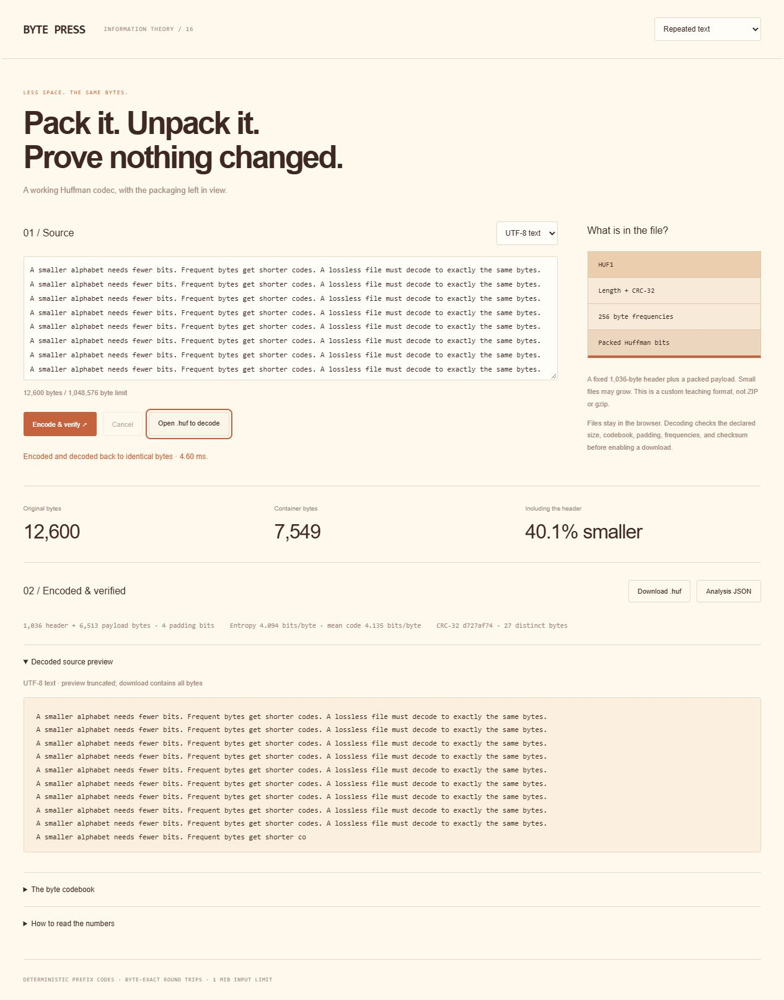

# Byte Press

A working lossless Huffman file codec with a browser workbench. Encode text or binary files, inspect the byte codebook, download the container, and decode it back with strict integrity checks.



## Run

```sh
python run.py
```

Open http://127.0.0.1:8000/. Requires Python 3.10+ and a browser supporting module Web Workers. Use `--port 8835` for another port. There are no runtime package dependencies. The server exposes five static assets; file bytes stay in the browser.

## Workflows

- Encode UTF-8 text or any binary file up to 1 MiB.
- Every encode is immediately decoded in the worker and compared byte-for-byte with the input.
- Download a `.huf` container, reopen it through **Open .huf to decode**, and download the verified original bytes.
- Compare original, payload, header, padding, and complete container sizes. Small or uniform-byte inputs can grow.
- Inspect empirical byte entropy, mean Huffman code length, CRC-32, and a filterable frequency/code table.
- Preview valid UTF-8 text or hexadecimal binary data. Previews are bounded; downloads contain all decoded bytes.
- Cancel worker execution or change inputs to invalidate stale results.

The repeated-text sample is 12,600 bytes and becomes a 7,549-byte container. The uniform 4,096-byte sample becomes 5,132 bytes: the payload stays at eight bits per byte and the header adds 1,036 bytes. These are fixed-example results, not general compression guarantees.

## HUF1 format

This is a custom, documented teaching format. It is **not ZIP, gzip, or DEFLATE**.

| Offset | Bytes | Meaning |
| --- | --- | --- |
| 0 | 4 | ASCII magic `HUF1` |
| 4 | 4 | Original byte length, unsigned little-endian |
| 8 | 4 | CRC-32 of original bytes, unsigned little-endian |
| 12 | 1024 | 256 unsigned little-endian 32-bit byte frequencies |
| 1036 | Variable | Huffman payload, most-significant bit first |

The tree is reconstructed from nonzero frequencies. Nodes sort by ascending weight, then minimum byte value in their subtree. Repeatedly merge the first two nodes: the first becomes the left (`0`) child and the second the right (`1`) child. A single-symbol alphabet uses code `0`. An empty input has no payload. This deterministic rule is part of the format, including tie-breaking.

The meaningful bit length is derived from the frequency table and resulting code lengths. The payload occupies the ceiling of that length divided by eight. Unused low bits in its last byte must be zero. No trailing data is accepted. Filenames and media types are not stored in the container.

CRC-32 uses the reflected polynomial `0xEDB88320`, initial value `0xFFFFFFFF`, and final XOR `0xFFFFFFFF`. The standard `123456789` check value is `0xCBF43926`. CRC detects accidental corruption; it is not cryptographic authentication or encryption.

Decoding validates magic, declared size, frequency sum, exact payload length, zero padding, complete tree traversal, output count, observed frequencies, and CRC. The declared output is checked against the 1 MiB limit before allocation. Containers are bounded to `1 MiB + 1,036` bytes. Files are downloaded only after successful decoding.

## Information-theory measurements

Entropy is calculated from empirical byte frequencies, not Unicode character frequencies. Mean code length describes the payload. The displayed size change includes the fixed header and padding. A one-symbol source has entropy zero but uses one payload bit per byte under this format's single-symbol convention.

The codec uses a static per-file alphabet with no dictionary, run-length stage, arithmetic coding, or adaptive context model. It intentionally exposes a simple prefix-code construction; it is not intended to outperform mature compression formats.

## Architecture

- `core.js`: deterministic Huffman tree, bit packing/unpacking, container validation, CRC-32, statistics, and bounded previews.
- `worker.js`: encoding/decoding and full round-trip comparison outside the UI thread.
- `app.js`: file/text selection, worker lifecycle, stale-result checks, codebook presentation, and downloads.
- `run.py`: explicit static allowlist, loopback binding, Host checks, and security headers.

The JSON analysis export includes statistics and the codebook, not the original file or encoded payload. Projects are not stored automatically.

## Verify

```sh
node --test
npm run check
python -m unittest discover -s tests -v
```

Node.js 22+ is needed for tests; no npm installation is required. Twelve JavaScript tests cover the standard CRC vector, empty/single-symbol cases, all 256 byte values, 180 seeded binary round trips, prefix-free codes and entropy bounds, an independent bitstream decoder, byte-offset views, corruption/truncation/padding rejection, oversized output headers, Unicode/binary previews, determinism, source immutability, and a 1 MiB round trip. One Python test verifies static assets including the worker, filesystem-route rejection, Host handling, and HEAD requests. CI runs on Linux and Windows.

Browser checks include downloading a container, reopening it, downloading decoded bytes, and comparing the result byte-for-byte outside the browser. Python zlib independently verifies the CRC. A deliberately altered checksum is rejected with downloads hidden. Uniform-byte overhead and file-mode visibility are also checked.

## References

- [RFC 1951: prefix and Huffman coding concepts](https://www.rfc-editor.org/info/rfc1951/)
- [RFC 1952: CRC-32 reference implementation](https://www.rfc-editor.org/info/rfc1952/)

These references inform the coding and checksum concepts; HUF1 has its own format defined above.
